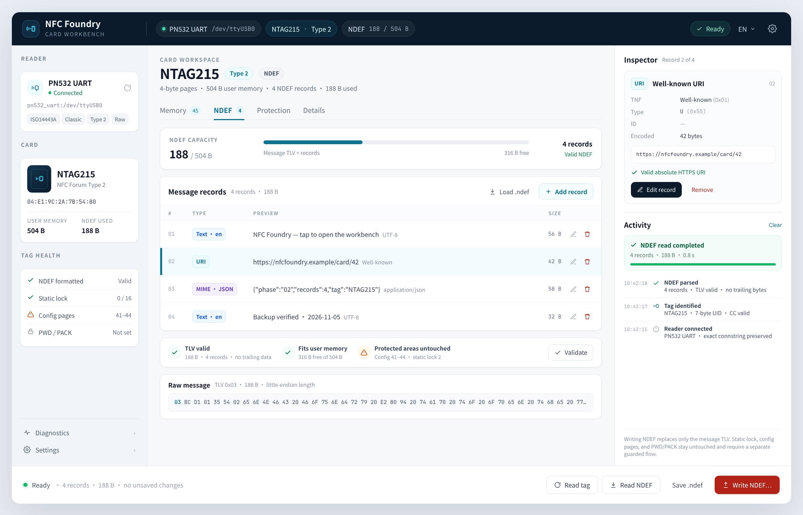

# Phase 02: MyGo shell

## Goal

Replace Wails with the MyGo native UI without changing the application
services. The shell follows the reviewed workbench mockup rather than the
previous sidebar-page layout.

## Design reference

- Design source: [`docs/design/02-workbench-ndef.html`](../design/02-workbench-ndef.html)
- Design index: [`docs/design/README.md`](../design/README.md)

The mockup is normative for layout, hierarchy, density, and component
placement. It is a static HTML design; the implementation uses MyGo native
controls with the same structure.

## Work

### Shell structure

- Replace the five-page sidebar navigation with one workbench:
  - **top bar**: app identity, exact reader connection, card identity, NDEF
    capacity/state when applicable, task state, language, settings;
  - **left rail**: reader card with capabilities, card identity, tag health,
    diagnostics/settings links;
  - **center workspace**: card title, family capability badges, capability-driven
    tabs, and the active family view;
  - **right panel**: selected-object inspector plus a persistent activity log;
  - **bottom action bar**: context actions and current operation state.
- Use the MyGo native controls to match the mockup's spacing, typography,
  dividers, badges, status colors, and empty/error states.
- Keep the left rail and activity log visible while switching tabs; do not
  rebuild them as separate pages.

### Card-family tabs

Tabs are driven by card family and reader capability, not by a fixed page list.

| Family | Tabs |
|---|---|
| MIFARE Classic | Blocks / Keys / Details |
| Type 2 / NTAG21x (Phase 05) | Memory / NDEF / Protection / Details |
| ISO14443-4 / DESFire (Phase 07) | Applications / Files / APDU / Details |
| FeliCa (Phase 08, if accepted) | NDEF only |

Phase 02 implements the shell and the Classic tabs. The Type 2/NDEF structure
shown in the mockup is a committed design target: the tab model and shared
regions must be in place, but the NDEF tab must not be filled with synthetic
data before Phase 05.

### Classic implementation

- Blocks tab: sector-grouped block table with manufacturer/data/trailer kind,
  hex and ASCII preview, dirty markers, and a selected-block inspector.
- Keys tab: sector A/B key matrix plus the persistent key catalog, add/delete,
  import/export.
- Details tab: card facts, dump geometry, validation state, and source UID.
- Bottom actions: Read card, Scan keys, Write changes…, Restore…; guard and
  disable actions exactly as the service requires.
- Existing write preflight, UID write, key recovery, and dump dialogs remain
  modal over the workbench. Do not add a generic write-all action.

### NDEF readiness

- Reserve the capacity bar, record list, record inspector, raw TLV pane,
  validation strip, and Read/Write NDEF actions in the shared workspace
  patterns.
- NDEF write must use a confirmation modal and must replace only the message
  TLV; config, lock, and PWD/PACK remain separate protected operations.
- Do not fake NDEF records, capacity, or validation in Phase 02.

### Localization and events

- Add English and Simplified Chinese catalogues; English is the base language.
- Render structured task events in the activity panel with localized labels,
  timestamps, progress, and cancellation.
- Keep technical log payloads in English.

### Build and packaging

- Keep the existing MyGo build, CI, packaging, and `libnfc-ng` integration.
- Remove the HTML/TypeScript frontend; the design HTML is documentation only.

## Acceptance

- The GUI starts at 1280x820 or larger and matches the mockup's region layout:
  top bar, left rail, center tabs, right inspector/activity, bottom action bar.
  There is no five-page sidebar navigation.
- A visual review compares the running shell with the mockup; differences are
  limited to card-family content and unavailable future tabs.
- The Classic workflow works: enumerate a reader, connect, show card facts, read
  a Classic card, show sector-grouped blocks, show the key catalog, and render
  task activity.
- Tabs are capability-driven. Classic shows Blocks/Keys/Details; Type 2/NDEF
  is not exposed or is clearly unavailable until Phase 05, without fake data.
- Language switch works; both catalogues are complete.
- `go test ./...` passes without Wails.
- No Wails import remains.
- A MyGo UI smoke test runs in CI and the shell starts under headless mutter.
- Type 2/NDEF tabs, dangerous write confirmations, and APDU/DESFire views are
  explicitly deferred to their phases.

## Non-goals

- No Type 2/NDEF implementation (Phase 05).
- No new card family, protocol, or write workflow.
- No `nfctl` CLI (Phase 03).
- No card emulation (Phase 09).
- No Wails feature parity beyond the initial workflow.
